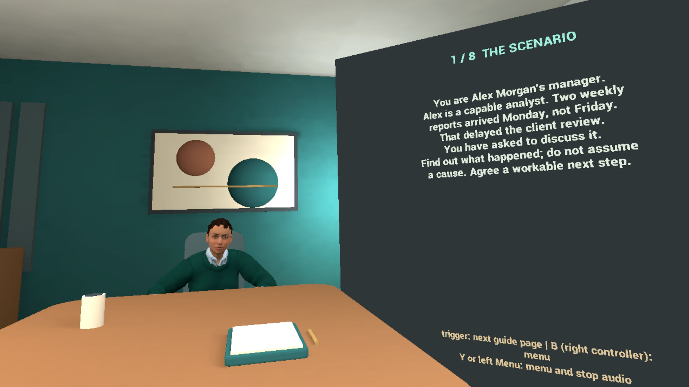
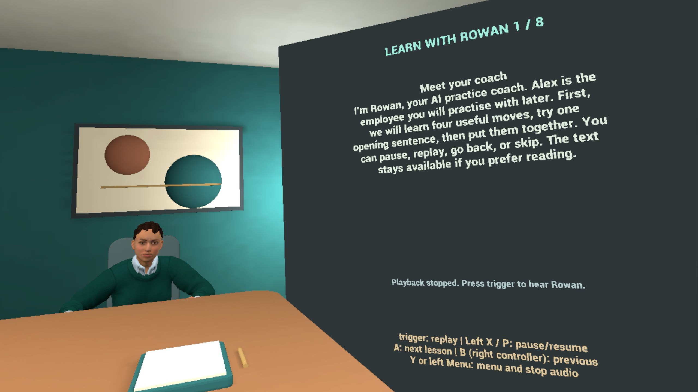
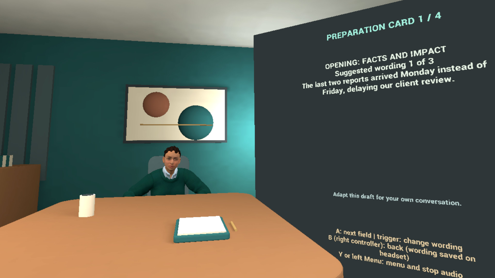

# Difficult Conversations at Work

**Find your words. Then put them into practice.**

A released Meta Quest learning experience for rehearsing a difficult workplace conversation: addressing missed deadlines, understanding another person's perspective, and agreeing on a practical next step.

**Created by [Samphy Y](https://ysamphy.com/) · An [UpskillsXR](https://upskillsxr.com/) experience · Published by YSAMPHY LLC**

[Get it on Meta Quest](https://www.meta.com/experiences/difficult-conversations-at-work/1312349648638114/) · [Explore the app](https://upskillsxr.com/difficult-conversations-at-work/) · [Read the case study](https://ysamphy.com/upskillsxr-immersive-workplace-learning/)

*Actual Quest capture from the store screenshot set. Screenshots were captured in an earlier build; interface details may differ from the current release.*

## Why I built it

Knowing a communication framework is different from finding the words in a real conversation. I wanted learners to rehearse a specific moment, hear a response, and try again with one clear improvement.

The app centers on one authored scenario. You manage Alex Morgan, an analyst whose last two weekly reports arrived on Monday instead of Friday, delaying a client review. Your task is to describe the facts and impact, explore what happened, and work toward an agreement.

## The learning experience

| Step | What the learner does | Design purpose |
| --- | --- | --- |
| Learn | Listen to Rowan's recorded lessons or read the panels. | Prepare a useful opening and a clear approach. |
| Practice | Speak with Alex, an AI colleague, using push-to-talk. | Respond to the conversation rather than select a scripted answer. |
| Reflect | Review feedback with a strength and one improvement priority. | Connect advice to the conversation where evidence is available. |
| Retry | Rehearse a focused moment with a brief. | Turn feedback into another attempt. |
| Prepare | Adapt a preparation card. | Carry useful wording into the next workplace conversation. |

Rowan is a spoken coach with readable panels. Alex is the colleague shown in the scene.

<strong>See the lesson and preparation screens</strong>

### Learn with Rowan

Recorded guidance supports replay and pause/resume, with a text alternative.

### Prepare your words

The preparation card helps the learner adapt wording. The example is fictional.

## My role

I connected learning design with hands-on product development: defining the workplace problem, writing the scenario and learning sequence, shaping the interactions, testing on Quest, and preparing the app for release.

The project brings together scenario writing, conversational interaction design, feedback design, accessibility considerations, and the practical work of shipping and improving a product.

## Design decisions that mattered

- **One concrete scenario.** Missed deadlines provide specific facts and consequences for the learner to address.
- **Learner-controlled speech.** Push-to-talk makes the speaking action explicit.
- **Readable and audible guidance.** Captions, larger text, and narration controls give learners different ways to follow the experience.
- **Continuity after interruptions.** Reconnecting should preserve a genuine conversation rather than silently start over.
- **Feedback with a next action.** Reflection leads into a focused retry and preparation card.
- **Clear session access.** The current update offers a “No sessions remaining” prompt with options to view packs or return to the menu.

## What testing taught me

Headset testing surfaced problems that a successful build alone did not reveal: inaccurate captions, replies cut short, interrupted conversations, and narration stopping at page boundaries.

The iteration focused on audio conversion, reconnect handling, and keeping narration continuous as feedback moves across pages. Subsequent headset checks confirmed correct captions, remembered conversation context after reconnecting, feedback recognizing facts and impact, and uninterrupted narration with pause/resume and menu exit.

The latest no-sessions prompt passed offline control and layout checks and was packaged, installed, and published as Build 48. Its live zero-balance interaction has not yet been verified on the headset.

These are functional checks. They do not establish measured learning gains, workplace outcomes, or a validated assessment.

## Availability

The app is released on the Meta Horizon Store. It includes one free practice per account and optional one-time packs of three additional Quest sessions at the price shown in Meta checkout. There is no subscription.

Tested on Meta Quest 3 with Touch controllers. AI practice requires internet access and microphone permission. Recorded Quest lessons and menus can work offline. A linked web companion supports typed or spoken practice; paid Quest sessions do not transfer to the web companion.

For current availability, instructions, and terms, use the [official app page](https://upskillsxr.com/difficult-conversations-at-work/).

## About this repository

This is a public product and learning-design showcase. It contains documentation and selected screenshots only. The production application and backend source remain private; this repository is not a runnable Unreal project.

Use fictional workplace details when practicing. AI responses, transcripts, and feedback can contain mistakes. The app is a practice tool, not a certification or an employment decision tool.

[App privacy notice](https://workplace-practice.ysamphy.workers.dev/Web/privacy.html) · [Contact UpskillsXR](https://upskillsxr.com/contact/) · [Samphy's portfolio](https://ysamphy.com/)

Screenshots and product materials are provided for viewing this showcase. See [RIGHTS.md](RIGHTS.md) for reuse information.

*Showcase updated November 12, 2026.*
